# Домашнее задание. Клеточные автоматы. Модель манхэттенского трафика

Клеточный автомат моделирует движение дорожного трафика на дискретной двумерной сетке с периодическими границами. Квадратное поле разделено на клетки: часть образует «улицы» шириной в одну клетку, остальные — «здания». По улицам пошагово движутся автомобили: красные (с запада на восток), синие (с юга на север), а при двусторонних дорогах — также жёлтые (с востока на запад) и зелёные (с севера на юг). Движение чередуется по фазам: сначала одновременно двигаются горизонтальные машины, затем вертикальные. Машины, ушедшие за край поля, появляются с противоположной стороны (периодические границы). Модель позволяет исследовать влияние плотности потока, геометрии дорожной сети, доли грузовиков и режима движения на статистические характеристики трафика: среднее число машин в пробке, динамику заторов и пропускную способность сети.

### 🚀 Инструкция по запуску

Модель написана на языке программирования Python и может быть запущена в большинстве интерактивных IDE. Программа работает в интерактивном режиме и запрашивает параметры через консоль: частоту дорог, размер поля, количество шагов, тип дорог, тип движения (равномерный/неравномерный), скорость, доли машин и грузовиков, размер окна. Проект состоит из следующих частей:

<ul>
  <li><code>main.py</code> — основной скрипт симуляции, визуализации и сбора статистики.</li>
</ul>

### 📊 Структура данных

**Входные параметры:**
* Частота дорог (каждая N-я клетка);
* Размер квадратного поля;
* Количество шагов симуляции;
* Тип дорог (1 — двусторонняя, 2 — односторонняя);
* Тип движения (1 — равномерный, 2 — неравномерный);
* Скорость при равномерном режиме (1–3 клетки/шаг);
* Доли красных, синих, жёлтых, зелёных машин (0…1);
* Доля грузовиков среди всех машин (0…1);
* Начальный размер окна в пикселях.

**Выходные параметры:**
* Числовые: число машин в пробке на каждом шаге, общее число машин, номер текущего шага и фазы;
* Графические: кадры симуляции (цветные клетки), график динамики пробок, GIF-анимация симуляции и графика.

### 📂 Структура репозитория
* `README.md` — текущий файл;
* `main.py` — основной скрипт симуляции и визуализации;
* `frames_simulation/` — папка с сохраненными GIF-анимациями;

### 📈 Результаты эксперимента

Ниже представлены результаты моделирования для различных конфигураций дорожной сети и режимов движения.
В каждом блоке: **сверху** — GIF-анимация симуляции, **снизу** — GIF-анимация графика динамики пробок (если применимо).

> 💡 Для просмотра изображений дождитесь полной загрузки страницы. При медленном интернет-соединении загрузка большого количества рисунков может занять некоторое время.

<h3>Эксперименты 1–16. Влияние параметров на пробки</h3>
<table style="border-collapse: collapse; width: 100%; margin-bottom: 20px;">
  <tr>
    <td width="50%" align="center" valign="top" style="padding: 10px; vertical-align: top;">
      <b>Эксперимент 1</b> 20 дорог, односторонняя, равномерное (1 кл/шаг), доля 0.1, грузовики 0 
      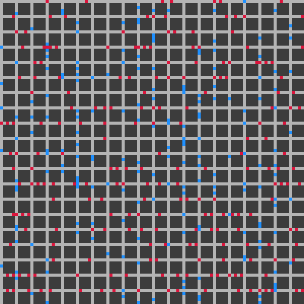
    </td>
    <td width="50%" align="center" valign="top" style="padding: 10px; vertical-align: top;">
      <b>Эксперимент 2</b> 10 дорог, односторонняя, равномерное (1 кл/шаг), доля 0.1, грузовики 0 
      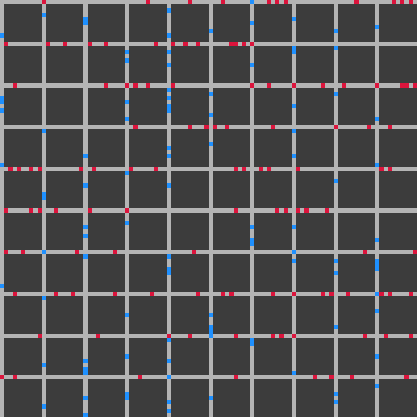
    </td>
  </tr>
  <tr>
    <td width="50%" align="center" valign="top" style="padding: 10px; vertical-align: top;">
      <b>Эксперимент 3</b> 5 дорог, односторонняя, равномерное (1 кл/шаг), доля 0.1, грузовики 0 
      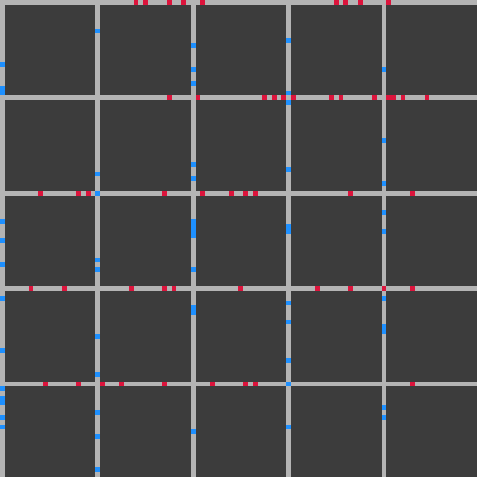
    </td>
    <td width="50%" align="center" valign="top" style="padding: 10px; vertical-align: top;">
      <b>Эксперимент 4</b> 20 дорог, двусторонняя, неравномерное, доля 0.1, грузовики 0 
      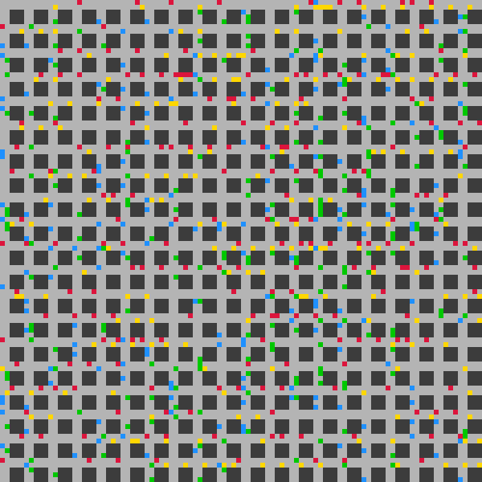
    </td>
  </tr>
  <tr>
    <td width="50%" align="center" valign="top" style="padding: 10px; vertical-align: top;">
      <b>Эксперимент 5</b> 10 дорог, двусторонняя, неравномерное, доля 0.1, грузовики 0 
      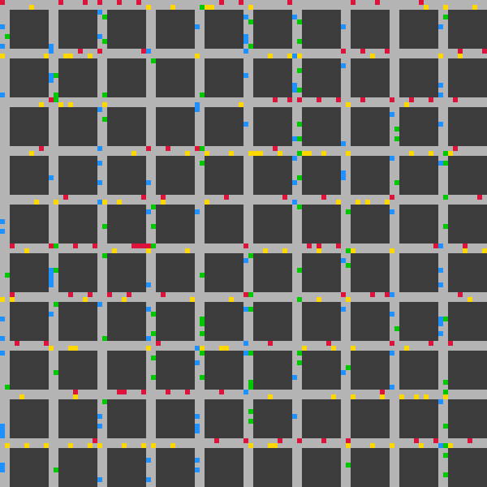
    </td>
    <td width="50%" align="center" valign="top" style="padding: 10px; vertical-align: top;">
      <b>Эксперимент 6</b> 5 дорог, двусторонняя, неравномерное, доля 0.1, грузовики 0 
      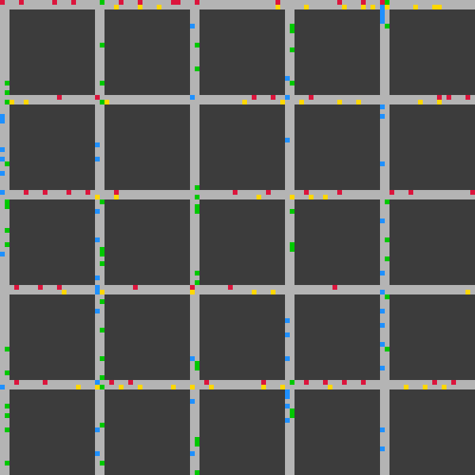
    </td>
  </tr>
  <tr>
    <td width="50%" align="center" valign="top" style="padding: 10px; vertical-align: top;">
      <b>Эксперимент 7</b> 20 дорог, односторонняя, равномерное (1 кл/шаг), доля 0.25, грузовики 0 
      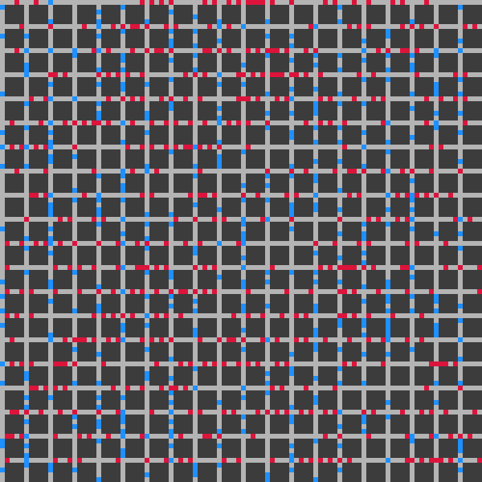
    </td>
    <td width="50%" align="center" valign="top" style="padding: 10px; vertical-align: top;">
      <b>Эксперимент 8</b> 20 дорог, двусторонняя, неравномерное, доля 0.05, грузовики 0 
      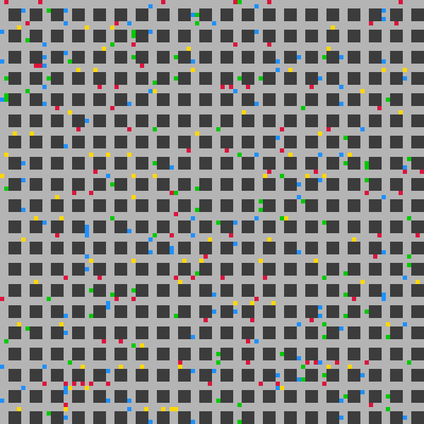
    </td>
  </tr>
  <tr>
    <td width="50%" align="center" valign="top" style="padding: 10px; vertical-align: top;">
      <b>Эксперимент 9</b> 20 дорог, односторонняя, равномерное (1 кл/шаг), доля 0.1, грузовики 0.2 
      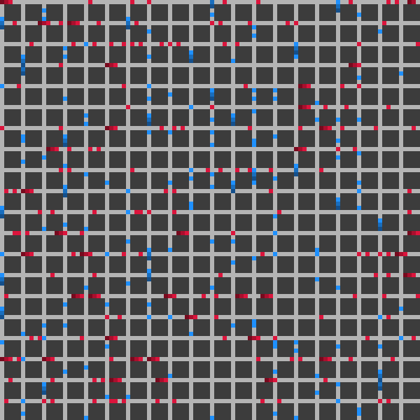
    </td>
    <td width="50%" align="center" valign="top" style="padding: 10px; vertical-align: top;">
      <b>Эксперимент 10</b> 5 дорог, односторонняя, равномерное (1 кл/шаг), доля 0.1, грузовики 0.2 
      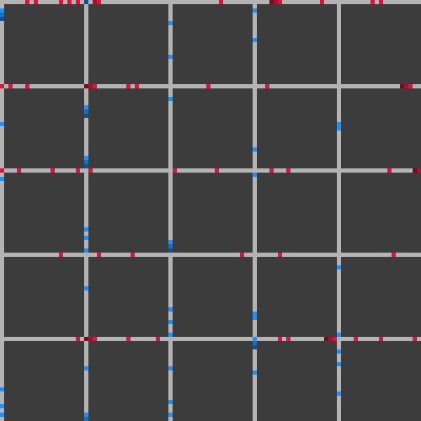
    </td>
  </tr>
  <tr>
    <td width="50%" align="center" valign="top" style="padding: 10px; vertical-align: top;">
      <b>Эксперимент 11</b> 5 дорог, двусторонняя, неравномерное, доля 0.1, грузовики 0.2 
      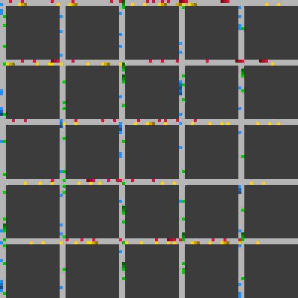
    </td>
    <td width="50%" align="center" valign="top" style="padding: 10px; vertical-align: top;">
      <b>Эксперимент 12</b> 20 дорог, двусторонняя, неравномерное, доля 0.1, грузовики 0.2 
      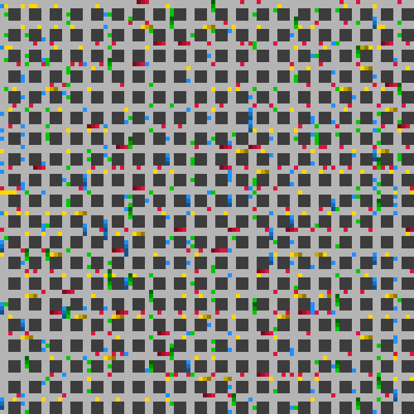
    </td>
  </tr>
  <tr>
    <td width="50%" align="center" valign="top" style="padding: 10px; vertical-align: top;">
      <b>Эксперимент 13</b> 20 дорог, односторонняя, равномерное (3 кл/шаг), доля 0.1, грузовики 0 
      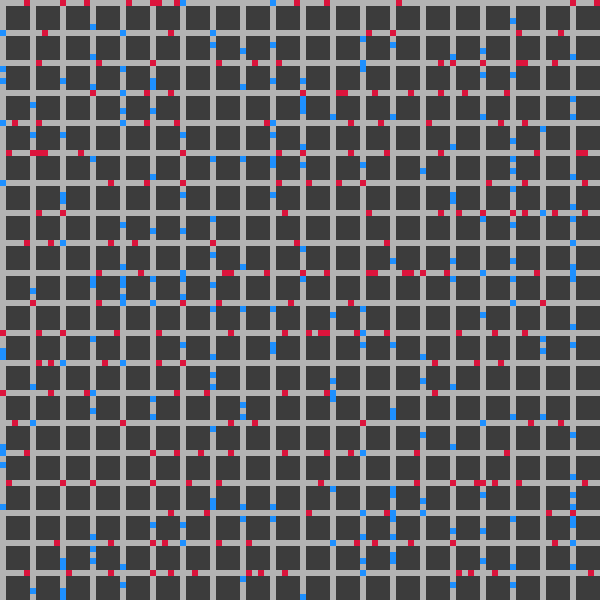
    </td>
    <td width="50%" align="center" valign="top" style="padding: 10px; vertical-align: top;">
      <b>Эксперимент 14</b> 5 дорог, односторонняя, равномерное (3 кл/шаг), доля 0.1, грузовики 0 
      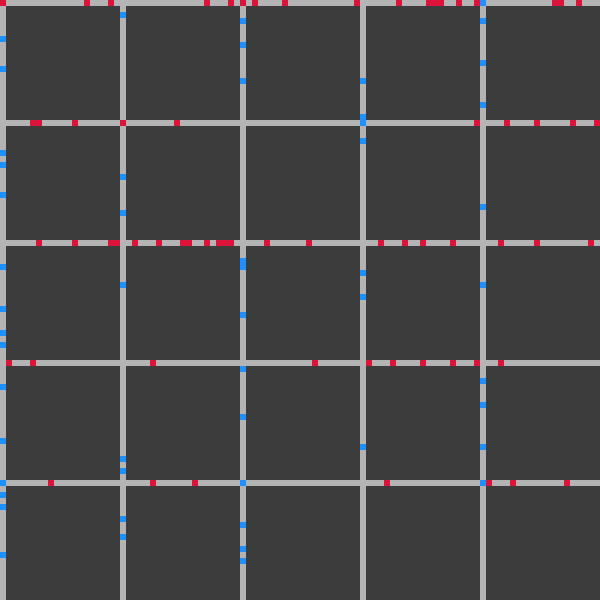
    </td>
  </tr>
  <tr>
    <td width="50%" align="center" valign="top" style="padding: 10px; vertical-align: top;">
      <b>Эксперимент 15</b> 20 дорог, двусторонняя, равномерное (3 кл/шаг), доля 0.1, грузовики 0 
      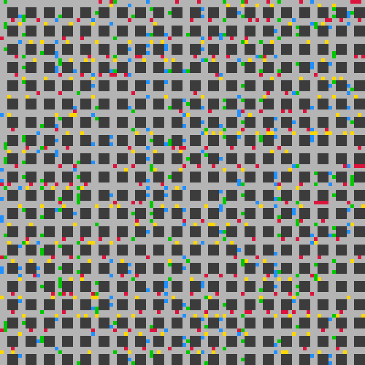
    </td>
    <td width="50%" align="center" valign="top" style="padding: 10px; vertical-align: top;">
      <b>Эксперимент 16</b> 20 дорог, двусторонняя, равномерное (3 кл/шаг), доля 0.1, грузовики 0.2 
      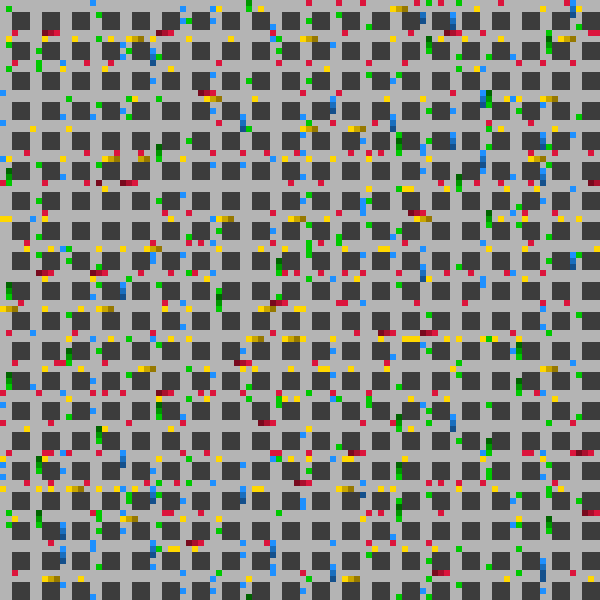
    </td>
  </tr>
</table>